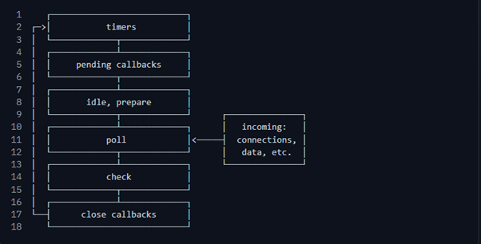
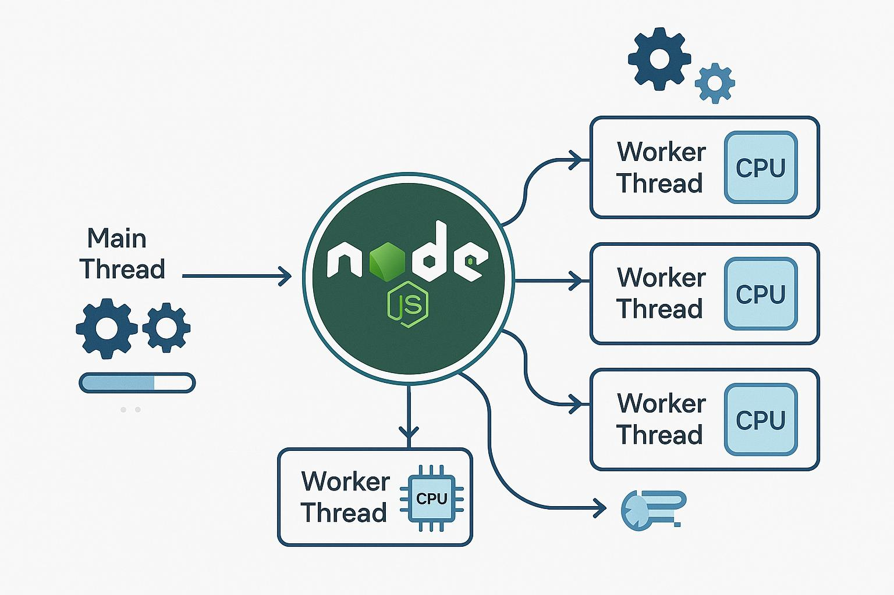

## What is Event Loop

The Event loop is what allows Node.js to perform non-blocking I/O operations – despite the fact that a single JavaScript thread is used by default – by offloading operations to the system kernel whenever possible.

Since modern kernels are multi-threaded, they can handle multiple operations executing in the background. When one of these operations completes, the kernel tells Node.js so that the appropriate callback may be added to the poll queue to eventually be executed. We’ll explain this in further detail later in this topic.



#### Timer Phase

- Execute callbacks schedules by `setTimeout` and `setInterval`
- If a time's delay has elapsed, its callback is added to the queue and executed in this phase

#### I/O Callbacks Phase

- Executes almost all callbacks from asynchronous I/O operations like `fs` or `net`

#### Idle, Prepare Phase

- Used internally by Node.js to prepare next phases

#### Pol Phase

- Retrieve new I/O events and executes their callbacks (if any exist)
- it also waits for I/O operations to complete if none are pending
- If no timers are scheduled and no I/O waiting, the event loop can pause in this phase

#### Check Phase

- Execute callback from `setTimeout`
- Callbacks schedules with `setIntermediate` are executed after the poll phase, regardless of I/O status

#### Close Callback Phase

- Handle close events such as when a `net`, `Socket` connection close
- If a socket or handle  closed abruptly the close event will be emitted in this phase. Otherwise it will emitted via `process.nextTick()`

#### `process.nextTick`

- `process.nextTick()` is a special function in node.js used to schedule a callback function to execute immediately after the current operation completes, before the event loop continues to the next phase.it allows developers to prioritize certain operations over other asynchronous tasks.
-

## What is Worker Thread

A worker thread is a separate thread of execution that allows Node JS to perform CPU intensive tasks in parallel without blocking the main event loop. Instead of doing all works b main thread you can delegate heavy tasks to worker threads.

### How Woker Thread work

{style="max-width: 100%;"}

- Main Thread: Handles incoming requests, callbacks and the event loop
- Worker Threads: Executes CPU-intensive Javascript independentaly.
- Communication: Main and worker threads exchange messages.

#### Practical Node JS Example

```
worker.js
---------
const {} = require('worker_threads');
function calculate(){
  let total = 0;
  for(let i = 0; i <=10000, i++){
    total +=i;
  }
  return total;
}

const result = calculate();
parentPort.postMessage(result);

```

```
main.js 
-------

const { Worker } = require('worker_threads');
const worker = new Worker('./worker.js');
worker.on('message', () => {
  console.log('Result')
});
worker.on('error', (error) => {
  console.error(error)
});
worker.on('exit', (code)=> {
  console.log('Worker stopped', code)
})

```

### Worker Threads vs Child Processes vs Cluster

| Feature | Worker Threads | Child Processes | Cluster |
| -------- | --------------- | --------------- | ------- |
| Execution | Separate threads | Separate process | Multiple processes |
| Memory | Can share memory | Separate memory | Separate memory |
| Communication | Message passing | IPC | IPC |
| Best for | CPU intensive tasks | Independed processes | Scaling HTTP servers |

### When should you use Worker Threads

- Image and Video processing 
- Encryption and hashing 
- Larage data processing 
- Complex mathematical calculations 
- CPU intensive algorithms 
- Generating large reports 
